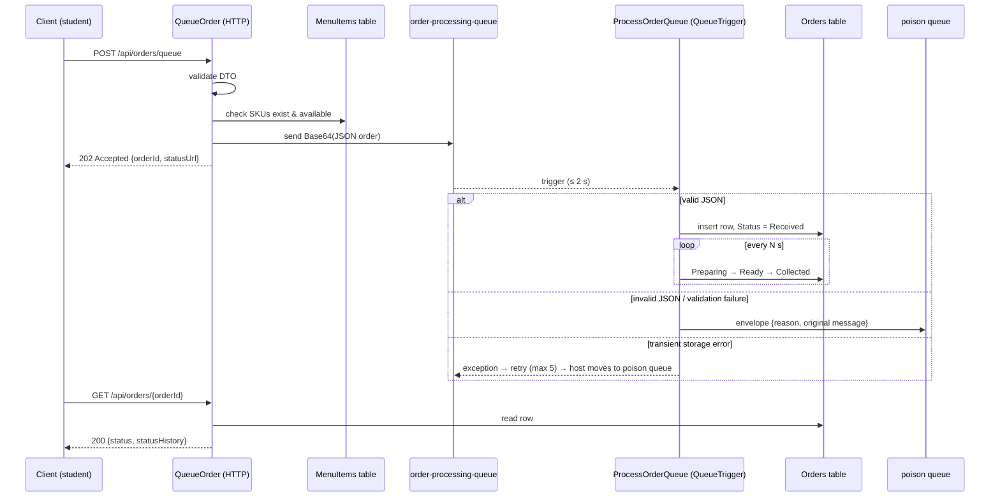

# CoffeeNChill – Architecture & Design Notes

## Components

| Component | Technology | Responsibility |
|---|---|---|
| Functions host | Azure Functions v4, .NET 8 isolated worker | HTTP APIs + queue trigger |
| `MenuItems` table | Azure Table Storage | PartitionKey = category, RowKey = SKU |
| `Orders` table | Azure Table Storage | PartitionKey = order date, RowKey = order id |
| `staff-docs` | Azure Files (cloud) / Blob container (Azurite) | Operational documents |
| `order-processing-queue` | Azure Storage Queue | Buffer between order placement and preparation |
| `order-processing-queue-poison` | Azure Storage Queue | Unprocessable messages + reason |
| Azurite | `coffeenchill-azurite` container | Local Azure Storage emulator |

## Order sequence

## Why these choices

* **Asynchronous queue** – during break-time peaks the HTTP request returns immediately; baristas work through the queue at their own pace and the system cannot be crashed by a burst of orders.
* **Table design** – menu partitioned by category makes the category filter a single-partition query; orders partitioned by date keeps "today's orders" cheap.
* **Forward-only status** – `Received → Preparing → Ready → Collected` can only advance, enforced in the repository with ETag concurrency so the simulator and a staff PUT can't corrupt each other.
* **Azure Files vs Azurite** – Azurite lacks Azure Files, so an `IDocumentStore` abstraction lets the same endpoints run on either a real File Share or an Azurite Blob container.
